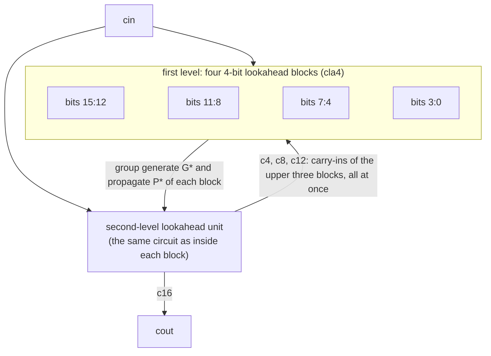

# Carry-lookahead adders, decimal adders and hazard-free logic: proven, timed and glitch-scanned

[](https://github.com/r800360/cla-adders-sv/actions/workflows/ci.yml)
[](LICENSE)

Gate-level SystemVerilog built from an explicit gate library:
* 16-bit ripple-carry, single-level and **two-level carry-lookahead adders**, the CLAs in the dual (product-of-sums)
  form;
* a 4-digit **2421 decimal adder** on top of each one;
* minimal, hazard-free and all-primes versions of two two-level functions.

Each circuit is analyzed three ways:
* **Function:** SAT proofs over every input.
* **Delay:** a transport-delay gate model, with the measured delays checked against hand derivations.
* **Glitches:** an automated scan of every single-input change, checked against the static-hazard analysis.



## Results

**Delay** (gate steps: NOT 2, AND/OR 5 + (n − 2), XNOR 7, XOR 9) when the carry-in changes and every bit propagates:

| Adder | c4 | c8 | c12 | c16 | top sum bit | slowest of 20 000 random input changes |
|---|--:|--:|--:|--:|--:|--:|
| ripple-carry | 40 | 80 | 120 | 160 | 159 | 148 |
| single-level CLA | 10 | 20 | 30 | 40 | 51 | 67 |
| **two-level CLA** | 10 | 12 | 14 | **10** | **35** | **55** |

The second lookahead level costs 16 % more gate inputs (326 against 280) and cuts the carry-in → c16 delay from 40
steps to 10.

**Correctness.** Yosys + ABC prove that:
* every binary adder equals `x + y + cin` for all 2³³ inputs;
* every 2421 adder equals decimal addition on all valid digits;
* all six two-level circuits equal their K-maps.

**Glitches.** Under the delay model, the minimal covers glitch exactly where the hazard analysis predicts. The
hazard-free covers glitch only on allowed transitions, and the all-primes covers never glitch.

## Reproduce

Every result comes from a pinned toolchain: Ubuntu 26.04 with Icarus Verilog 12.0, Verilator 5.032 and Yosys 0.52
(see [`scripts/install-tools.sh`](scripts/install-tools.sh)).

```bash
docker build -t cla-adders-sv .
docker run --rm -u "$(id -u):$(id -g)" -v "$PWD":/work cla-adders-sv make ci   # everything, ~2 minutes
```

`build/SUMMARY.md` collects every result.

| Target | What it runs |
|---|---|
| `lint` | Verilator lint |
| `sim` | functional tests (Icarus and Verilator), the delay measurements and the glitch scan (Icarus) |
| `formal` | equivalence proofs and negative controls |
| `gates` | structural gate counts |
| `synth` | Yosys netlists |

* The *CI* workflow runs `make ci` on every push and uploads `build/`.
* *Full verification* runs the same on demand or for a `v*` tag. A tag also publishes a release.

## Repository map

```
rtl/gates.sv        gate library; +define+GATE_DELAYS adds transport delays
rtl/cla.sv          lookahead unit, cla4, single- and two-level 16-bit CLAs, ripple-carry adder
rtl/adder2421.sv    +-6 corrector and 4-digit 2421 adder on any of the three binary adders
rtl/hazard_free.sv  minimal, hazard-free and all-primes covers of two functions
tb/                 tb_adders.sv (function), tb_timing.sv (delays), tb_hazard.sv (glitches)
formal/             equivalence harness, pdr.sh, run_formal.sh
docs/               DESIGN.md (derivations), VERIFICATION.md (every check, tool invocations)
```

Origin: these circuits began as assignments in a university digital-design course. This repository is an independent
SystemVerilog re-implementation that adds the proofs, the delay measurement and the glitch scan.

MIT License, © 2026 Rohan Sachdeva.
